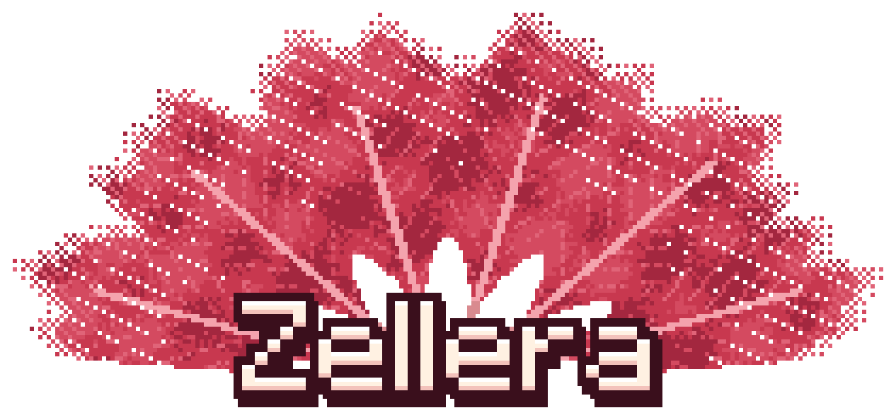

<p align="center"></p>

<p align="center">
<b>A virtual-world game server, written from scratch.</b><br>
Players build and furnish isometric rooms, bring them to life with wired,<br>
play games, keep pets, join groups and trade, all in the browser.
</p>

<p align="center">
<a href="#start">Start</a> ·
<a href="#what-it-can-do">What it can do</a> ·
<a href="#content-packs">Content packs</a> ·
<a href="#configuration">Configuration</a> ·
<a href="#server-sizing">Server sizing</a> ·
<a href="#license">License</a>
</p>

Zellera is the server: the room engine, every game system, the web site, housekeeping and a public Web API. It ships
no client and no content. You bring a client and a content pack, and the pack decides what the world looks like and
what everything in it is called. `./zel start` runs it all on your own computer, server or container.

## What is in it and what you bring

| Part | From | What it is | Where it goes |
|---|---|---|---|
| **Server** | the release bundle | the room engine and every game system, built into one jar that runs on Java 25 | the bundle's top folder; a source checkout builds it ([Build from source](#build-from-source)) |
| **Web** | the release bundle | the site, housekeeping and the public Web API, with their themes and extensions (Node.js 22) | `web/`, started by `./zel start` |
| **Database** | the release bundle | the schema; the server makes and upgrades the tables itself | `.data/` |
| **Your own** | you | your settings, game rules, themes, web extensions and game extensions | `config/*.local.*` and `custom/` |
| **Client** | you bring | the game client, a built folder that is ready to serve | `client/` (`ZEL_CLIENT_DIR`) |
| **Content pack** | you bring | the world: furni, rooms, the navigator, the catalogue, currencies, achievements, badges and every text | `./zel import <pack.zip>` |
| **Images** | you bring, with the pack | the pictures the pack names | `.data/assets/` (`ZEL_ASSET_DIR`) or a host (`ZEL_ASSET_URL`) |

The server has no furni, rooms, texts or names built in, so it does not start without a pack. A pack is imported into
the database and `.data/assets/` rather than unpacked next to the game, so there is no content folder; `client/` is
the folder you put the client in.

## Content packs

A pack is a zip with a manifest and one JSON-lines file per table, so it is plain data you can read, diff and build
with any tool. The server names nothing itself. Everything below comes from the pack, and what a pack leaves out is not
there:

- **The world**: furni definitions and their behaviour, rooms and room models, the navigator, news, the players that own
  public content.
- **The shop**: catalogue pages and the page layouts they use, offers, limited sales, clothing, vouchers, gifts.
- **Names and roles**: the currencies with their names and what each one is for, the names of the club and the build
  pass, the avatar effects the game puts on units (team colours, freeze, teleports, riding), chat bubble styles, camera
  filters, pet types and the boxes that hatch them.
- **Progress**: achievements, quests, daily tasks, reward tracks, badges.
- **Words**: every text the server and the web say, and the client profile.

Because nothing is fixed in code, packs can differ completely in style: another currency set and other names, their own
catalogue layouts, a different furni line, another tone of text. Two packs on the same server are two different games.
The pack format is versioned; `./zel import` refuses a pack it cannot read and says which formats it takes.

## What it can do

### Room engine

- Floor plans and height maps, walking and pathfinding, stacking, sitting and lying, doors and teleports, rollers, a
  500 ms room tick.
- Furni of every kind: dimmers, jukeboxes, gifts, mystery boxes, crackables, post-its, mannequins, badge displays, room
  paint, clothing and pet furni, room ads, rentable spaces and more.
- Floor plan editor, room settings, rights, bans and mutes, spectators, room events.
- Build pass: placing from the catalogue without owning the furni, with room locks and warnings.

### Wired

- A full set of triggers, effects, conditions, selectors, add-ons and variable boxes.
- Variables on users, furni and the room, signals, chests, clocks and counters, scores and teams, movement, bot effects,
  rewards, text placeholders and logs.
- Wired runs on the room tick: every stack fires in a fixed, predictable order.

### Games

- **Snowball**: a team game with its own lobby and arenas, free or daily games and tokens.
- Room games: **Tile Claim**, **Freeze**, **football** and **tag** fields, with clocks, team gates and scoreboards, all
  usable from wired.
- **Game extensions**: a jar that runs inside the rooms, for game modes that need more than wired, such as vehicles,
  role-play rules or a whole game of your own ([GAME-EXTENSIONS.md](docs/GAME-EXTENSIONS.md)).

### Players and social

- Messenger with friends, offline messages and requests; groups with their own forums.
- Trading, respects, badges, achievements, levels, quests, daily tasks and reward tracks.
- Pets with energy, thirst, happiness, commands, levels and breeding; horses; bots.
- Camera and photos, looks and clothing, chat bubbles, polls, community goals, treasure hunts, calendar campaigns,
  crafting and featured looks.

### Economy

- Catalogue and build pass catalogue, gifts and vouchers; credits, activity points, a premium currency and a seasonal
  currency, all named by the pack.
- Marketplace with tokens, the earnings center with a daily gift, the recycler, mystery boxes and claims.
- Every number is a game rule in `config/game-rules.conf`: starting wallet, limits, pets, rollers, opening hours,
  message rates and more.

### Moderation and safety

- In-client mod tool: tickets, chat logs, room visits, sanctions on a ladder, mutes, bans, device bans.
- Call for help, reports and the safety quiz; a word filter for chat and the site.
- Housekeeping on the web (`/housekeeping`): players, rooms, tickets, help requests, chat logs, staff, device bans, news,
  the landing view and an audit log of every action.

### Web

- Game page and site with registration, login, profiles, groups, photos, rooms, staff, news and help, as a **theme** of
  static files on top of the site API ([THEMES.md](web/docs/THEMES.md), [SITE-API.md](web/docs/SITE-API.md)). Swap the
  theme, keep the game.
- Housekeeping API ([HK-API.md](web/docs/HK-API.md)) and a **public Web API** for other sites, documented on
  `/api/public/api-docs/`.
- **Web extensions** in `web/extensions/<name>/` ([EXTENSIONS.md](web/docs/EXTENSIONS.md)): a site feature with its
  own routes and tables, with a guestbook as example.
- Avatar imager, asset mirror (fetches missing images from a host once and keeps them) and a client profile.
- Signed `HttpOnly` session cookies and rate limits; production mode refuses dev logins.

### Running it

- `./zel`: start, stop, restart, status, logs, import, backup, restore, doctor, upgrade and systemd units.
- Four ways to reach the game: this computer only, your own domain with automatic HTTPS (Caddy), a Cloudflare Tunnel
  (quick or named), or your own proxy in front (nginx and Traefik examples in `docs/`).
- TLS on every connection, plus a key exchange that encrypts the game's stream.
- Backups while the game runs, upgrades with a way back ([UPGRADING.md](docs/UPGRADING.md)), and your own files in
  `custom/` and `*.local.*` never touched.

## Requirements

Java 25 (a runtime is enough), Node.js 22 or newer and MariaDB 11 or newer. Caddy 2 unless you bring your own proxy;
`cloudflared` only for a Cloudflare Tunnel; `unzip` for upgrades. `./zel doctor` checks this computer against your
configuration.

## Start

Download `zellera-<version>.zip` from the [releases](https://github.com/ssl/zellera/releases), then:

```
unzip zellera-<version>.zip
cd zellera-<version>
./zel doctor              # what this computer still needs
./zel import <pack.zip>   # once, before the first start
./zel start               # on this computer; --public adds a quick tunnel to the internet
./zel status
./zel stop
```

The server comes built, so nothing is compiled. Your settings go in `config/zellera.local.env`, your themes and
extensions in `custom/`; `./zel upgrade` replaces the bundle's own files and leaves yours alone.

`./zel help` lists the rest: `logs`, `backup`, `restore`, `upgrade` ([UPGRADING.md](docs/UPGRADING.md)) and
`install-service`, which runs the game under systemd on Linux. Everything the game makes stays in `.data/`.

## Configuration

Settings are commented in `config/zellera.env`; put your own in `config/zellera.local.env`. Game rules are in
`config/game-rules.conf`, your own in `config/game-rules.local.conf`. `ZEL_PROXY` chooses how players reach the game:
this computer only, a domain with automatic HTTPS, a Cloudflare Tunnel, or your own proxy
([PROXY.md](docs/PROXY.md)).

The key exchange that encrypts the game's stream is on by default and needs nothing: the first start makes this
installation's own key in `secrets/rsa.env`. `ZEL_KEY_EXCHANGE=0` in `config/zellera.local.env` turns it off,
`ZEL_KEY_FILE` names a key of your own. TLS is what secures the connection; the key exchange only hides the game's
traffic from someone reading the websocket in a browser.

## Themes and extensions

Three ways to add your own without changing the code here:

| Kind | What it is | Where it lives | Turned on by | Guide |
|---|---|---|---|---|
| **Theme** | the look of the site: static files on top of the site and housekeeping APIs | `web/themes/<name>/`, yours in `custom/themes/<name>/` | `ZEL_WEB_THEME` | [THEMES.md](web/docs/THEMES.md), [SITE-API.md](web/docs/SITE-API.md), [HK-API.md](web/docs/HK-API.md) |
| **Web extension** | a feature of the site that needs its own routes and tables | `web/extensions/<name>/`, yours in `custom/extensions/<name>/` | `ZEL_WEB_EXTENSIONS` | [EXTENSIONS.md](web/docs/EXTENSIONS.md) |
| **Game extension** | a jar that runs inside the game server's rooms: it hears what happens in a room, acts every tick and can take over walking | `custom/game-extensions/<name>/` | `ZEL_GAME_EXTENSIONS` | [GAME-EXTENSIONS.md](docs/GAME-EXTENSIONS.md) |

An upgrade never touches `custom/`, so your own themes and extensions stay as they are.

## Build from source

For working on the engine itself. A git checkout runs like the bundle, but `./zel start` first builds the server from
`server/` (a JDK 25; a few minutes the first time) and installs the web's packages with npm:

```
git clone https://github.com/ssl/zellera.git
cd zellera
./zel doctor
./zel import <pack.zip>
./zel start
```

`cd server && ./gradlew build` builds and checks the server on its own. A checkout that sits exactly on a release tag
can take that release's jar instead of building (`ZEL_BUILD` in `config/zellera.env`), and `./zel upgrade` moves a
checkout to the next tag ([UPGRADING.md](docs/UPGRADING.md)). `lib/bundle.sh` makes the release bundle from a
checkout, after `./gradlew shadowJar`.

## Server sizing

Tested with up to 1000 headless players online at once, each doing the full login and then walking, talking, clicking
furni, browsing the catalogue and the navigator, playing games and moving between rooms, busy and wired ones among
them. At 1000 players the server used a fifth of one core and about 90 MB of live heap, with no slow room ticks and no
errors. The rows above 1000 are worked out from those numbers.

| Players online | vCPU | RAM | `ZEL_SERVER_HEAP` | `ZEL_DB_BUFFER_POOL` |
| ---: | ---: | ---: | ---: | ---: |
| 500 | 2 | 2 GB | 512m | 128M |
| 1000 | 2 | 4 GB | 1g | 256M |
| 2000 | 4 | 6 GB | 1g | 512M |
| 5000 | 8 | 12 GB | 2g | 1G |

## License

Copyright © 2026 the Zellera authors. Source: <https://github.com/ssl/zellera>.

Zellera is free software: you can use, change and share it under the GNU Affero General Public License, version 3
or (at your option) any later version, see [LICENSE](LICENSE). It comes with no warranty. If you run a changed version
for players over a network, offer them its source (section 13).

The copyright notice and the additional term below are also in [NOTICE](NOTICE), which every copy keeps next to
LICENSE.

Additional term (section 7(b)): every version, changed or not, keeps the attribution and legal notices that the
`:about` window shows: the copyright line, the name Zellera, the license, the no-warranty notice and the link to
the Zellera source. They stay where players can see them in the game; you may add your own credits and a link to
your own source next to them.
